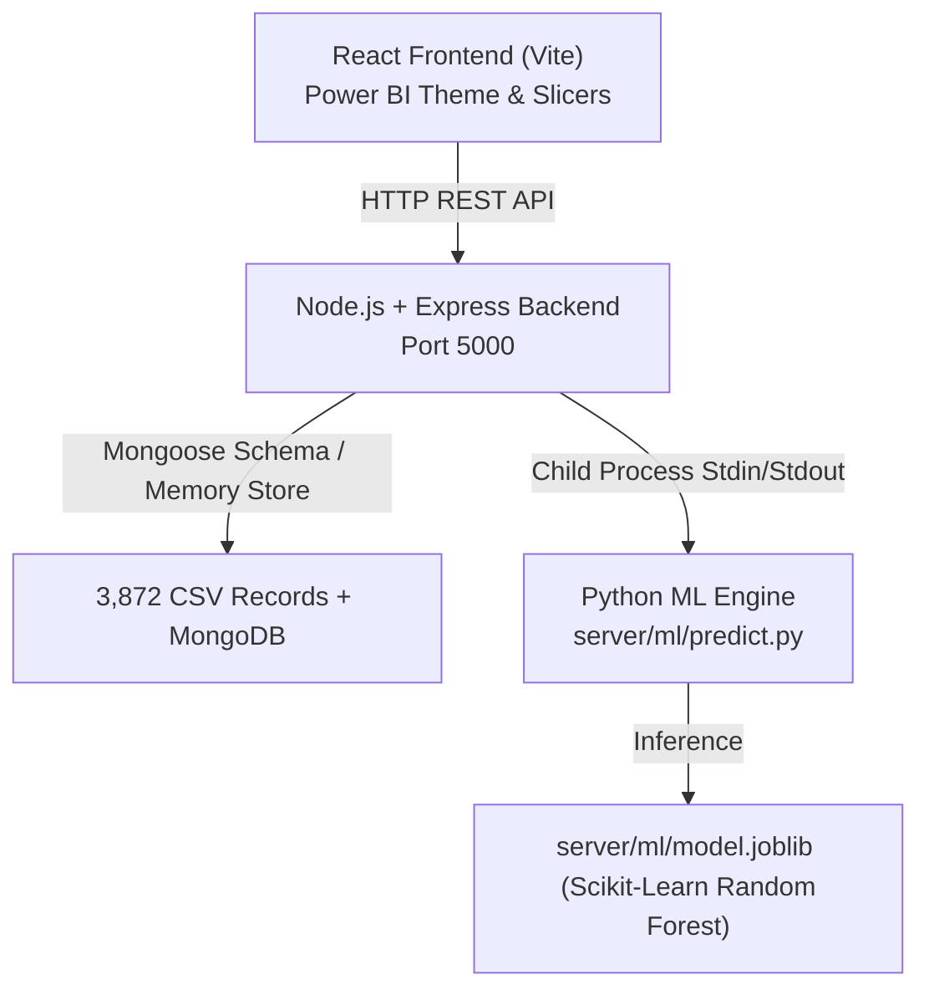

# Air Quality Dashboard Mumbai 2018–2020 (Power BI + MERN + ML)

Data Visualization Mini Project — **Group I012, I026, I034**

A full-stack **MERN** application featuring a pixel-perfect **Power BI-style frontend** and an integrated **Scikit-Learn Python Random Forest Regressor** backend for live same-day Air Quality Index (AQI) estimation.

---

## 📊 1. Understanding the ML Pipeline (`ML_Pipeline.ipynb`)

### Core Objective

The machine learning model performs **same-day AQI estimation** (continuous regression) based on measured concentrations of atmospheric pollutants. It does not perform multi-day time-series forecasting; rather, it learns the functional mapping from ambient pollutant readings to the Indian CPCB Air Quality Index.

### Dataset & Geographic Data Limitation Finding

- **Input Data Sources:** Kaggle India Air Quality `station_day.csv` (historical daily readings 2015–2020),`stations.csv` (station metadata), and `station_coordinates_external.csv` (external latitude/longitude geocoding).
- **Key Insight from Notebook (Section 5):**
  - While `stations.csv` lists 13 monitoring stations across Mumbai and Navi Mumbai, the historical measurements table `station_day.csv` contains observations **only for the 10 Mumbai stations** (3,872 valid station-days).
  - The 3 Navi Mumbai stations (`MH017` Airoli, `MH018` Mahape, `MH019` Nerul) have **zero observation rows** in the supplied Kaggle dataset.
  - Adding coordinates allows geocoding on the map, but cannot fabricate historical data. The Random Forest model is properly trained only on observed Mumbai stations.

### Preprocessing & Engineering

- **Date Range:** 2018-05-07 through 2020-07-01.
- **Features Extracted:** `year`, `month`, `quarter`, `day_of_week`, `season` (Winter, Summer, Monsoon, Post-Monsoon), and `aqi_category` (Good, Satisfactory, Moderate, Poor, Very Poor, Severe).
- **Train/Test Split:** Chronological 80/20 split (3,097 train rows, 775 test rows).
- **Missing Value Strategy:** Handled using `SimpleImputer(strategy='median')` fitted strictly on training data.

### Model Architecture & Performance

- **Algorithm:** `RandomForestRegressor(n_estimators=300, min_samples_leaf=2, random_state=42, n_jobs=-1)`
- **Evaluation Metrics:**
  - **Mean Absolute Error (MAE):** `8.05`
  - **Root Mean Squared Error (RMSE):** `12.29`
  - **$R^2$ Score:** `0.738`
- **Predictor Importance Hierarchy:**
  1. `pm10` (Coarse Particulate Matter): **70.1%**
  2. `pm2_5` (Fine Particulate Matter): **18.0%**
  3. `nox` (Nitrogen Oxides): **4.5%**
  4. `co` (Carbon Monoxide): **3.0%**
  5. `no`, `o3`, `no2`, `nh3`, `benzene`, `so2`: Remaining **4.4%** combined.

---

## 🚀 2. System Architecture



### Components

1. **Frontend (`client/`)**:
   - Power BI Canvas design system with custom CSS variables, light/dark themes.
   - Exact Power BI KPI tiles: **Average AQI (103.06)**, **Average PM2.5 (36.67)**, **Maximum AQI (323)**, **Poor or Worse Days (333)**, and **MAE (8)**.
   - Interactive charts: Multi-line AQI Trend Chart, Horizontal Station Ranking Bar Chart, Pollutant vs AQI Scatter Plot, Leaflet Geo Map of CAAQMS stations, AQI Category Donut Chart, and Actual vs Predicted Regression Validation.
   - Right Slicers Sidebar for cross-filtering by Year (2018, 2019, 2020), AQI Category, Season, and Station.
   - Interactive **Live ML Predictor Modal**: Sliders for pollutants, preset scenarios ("Clean Monsoon", "Winter Inversion", "Severe Smog"), dynamic gauge, and health advisories.
2. **Backend (`server/`)**:
   - Express REST API (`/api/analytics/*` and `/api/ml/*`).
   - Mongoose data model (`server/models/AQIRecord.js`) + indexed in-memory datastore with full multi-attribute filtering.
   - Python ML integration via `server/ml/predict.py` with serialized `model.joblib` and `metadata.json`.

---

## 🌐 3. Deploying to Render (Full-Stack + Python ML)

### Method 1: Single Web Service (Recommended - Free Tier Friendly)
Because the Express backend serves the built React frontend (`client/dist`), you can host the **entire full-stack application on a single free Render Web Service**.

1. Push your repository to **GitHub**.
2. Log in to [dashboard.render.com](https://dashboard.render.com/).
3. Click **New +** > **Web Service**.
4. Connect your GitHub repository.
5. Configure the service:
   * **Name:** `mumbai-aqi-analytics`
   * **Region:** Any (e.g. *Oregon* or *Singapore*)
   * **Language / Runtime:** `Node`
   * **Build Command:**
     ```bash
     npm run render-build
     ```
   * **Start Command:**
     ```bash
     npm start
     ```
   * **Instance Type:** `Free`
6. Under **Environment Variables**, add:
   * `NODE_ENV` = `production`
   * `PYTHON_PATH` = `python3`
7. Click **Create Web Service**. Render will automatically install both Node and Python dependencies, build the frontend, and launch the unified application!

---

### Method 2: Docker Web Service (100% Guaranteed Python Environment)
If you prefer containerized isolation:
1. In Render, select **New +** > **Web Service** > Connect GitHub Repo.
2. Select **Runtime:** `Docker`.
3. Render will automatically detect the included [`Dockerfile`](file:///c:/Users/Shubham/Desktop/My%20Works/DV%20Mini%20Project/Dockerfile).
4. Click **Create Web Service**.
